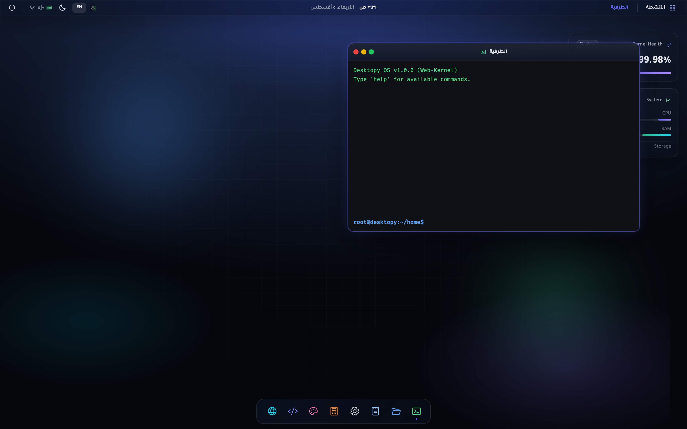
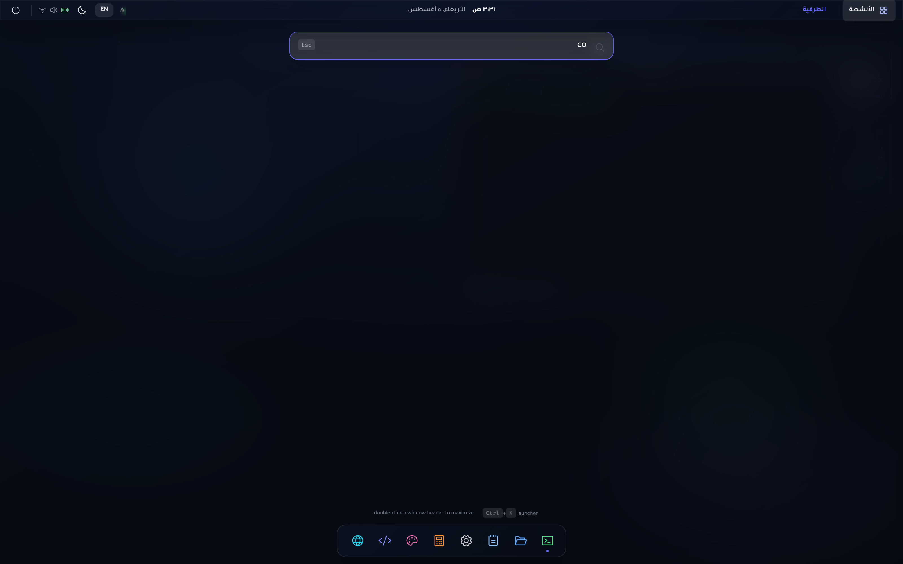
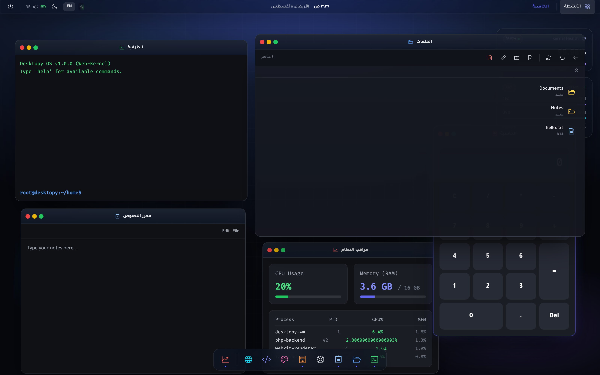
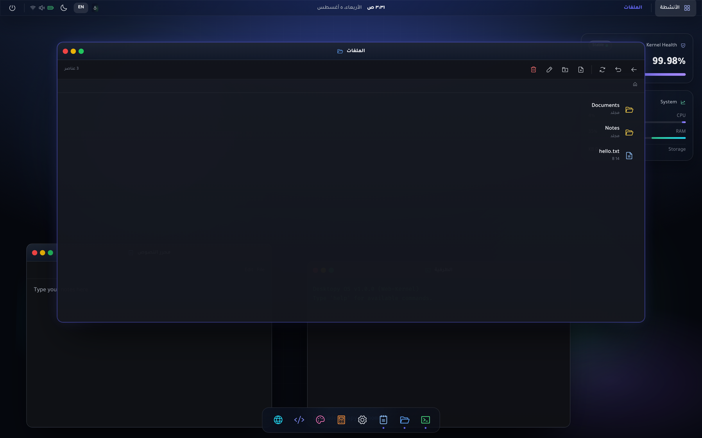
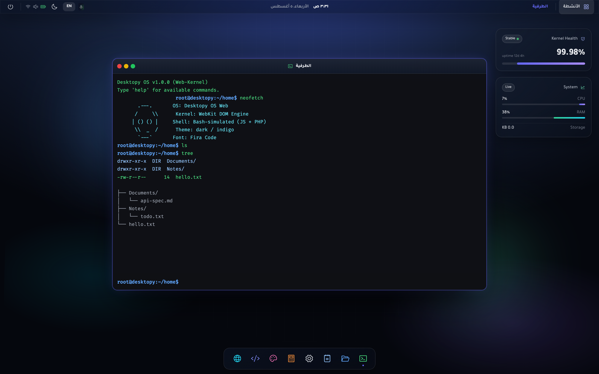
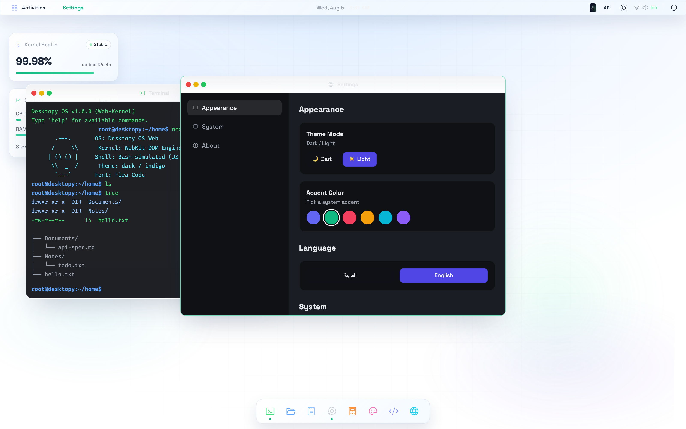

# 🖥️ Web Live Linux — Desktopy OS

A browser-based desktop operating system. Every window, file and setting you
touch is real: the GUI is a single HTML file, and **everything that needs a
file system runs through a single-file PHP backend** — window positions,
minimized/maximized states, theme, language, notes, terminal history, and an
actual sandboxed file explorer.

Arabic-first (RTL) with full English (LTR) support, dark/light themes, and
accent colors.

## Screenshots

| | |
| --- | --- |
|  |  |
| Welcome desktop — glassmorphism, live widgets, terminal | App launcher with instant search |
|  |  |
| Window manager — drag, snap, resize, cascade | Files app backed by the PHP file system |
|  |  |
| Terminal with real `ls` / `tree` / `cat` over PHP | Light theme, English UI, accent colors |

## Features

- **Window manager** — open/close/minimize/maximize, drag with edge snapping
  (top = maximize, sides = half-screen), 8-direction resize, double-click to
  maximize, focus glow, smooth animations.
- **PHP persistence** — every interaction is saved to `data/state.json` and
  restored on reload: open windows, their **positions, sizes, minimized and
  maximized states**, z-order, theme, language, accent, notes and terminal
  history. Gracefully falls back to `localStorage` when no PHP server is used.
- **Real file system** — the Files app lists, reads, writes, creates, renames
  and deletes files inside the PHP sandbox; the Terminal speaks to the same
  backend (`ls`, `cd`, `cat`, `mkdir`, `touch`, `rm`, `write`, `tree`, …).
- **App launcher** — search-driven grid, `Ctrl/Cmd+K` shortcut, `Esc` to close.
- **Dock** — pinned + running apps with macOS-style magnification and tooltips.
- **Desktop widgets** — live Kernel Health and System (CPU / RAM / storage) cards.
- **Right-click desktop menu** — quick actions: terminal, files, settings,
  theme/language toggle, reset desktop.
- **Notifications, dialogs, context menus, toasts** — a complete, cohesive UI.
- ~20 apps: Terminal, Files, Text Editor, Settings, System Monitor, Calculator,
  Paint, Code Studio, Tic-Tac-Toe, and more.

## Quick start

Requires **Node 18+** and **PHP 8+** (for the full experience).

```bash
# Option A — Node server that proxies .php to the PHP CLI
npm install
npm run serve          # http://localhost:3000

# Option B — native PHP server (preferred)
npm run serve:php      # php -S localhost:3000 -t public
```

Without PHP the desktop still runs — state falls back to `localStorage` and
file-system features show an "offline" notice.

## Architecture

```
public/
  index.html     # the entire frontend (GUI + window manager + apps)
  api.php        # the entire backend (single PHP file)
  logo.png
  data/          # runtime data (gitignored)
    state.json   # persisted desktop state
    home/        # sandboxed user files ("the disk")
scripts/
  screenshots.mjs  # regenerates docs/screenshots (npm run screenshots)
tests/             # Playwright e2e (npm run test:e2e)
docs/
  BACKEND.md       # PHP API reference
  screenshots/     # UI gallery
```

The backend is deliberately **one file** — see
[docs/BACKEND.md](docs/BACKEND.md) for the full API reference, including the
sandbox rules and the persisted state schema.

## Persistence model

The frontend keeps a single `state` object. Any change (moving, resizing,
opening, closing, minimizing, maximizing, focusing, theme/language/accent,
notes, terminal history) triggers a debounced save that POSTs the **complete
snapshot** to `api.php?action=state`. A `beforeunload` flush guarantees nothing
is lost on reload.

## Testing

```bash
npm run test:e2e
```

16 end-to-end tests cover branding, launcher, widgets, terminal boot, **window
position / minimized / empty-desktop persistence**, theme & language
persistence, the file-system API round-trip, sandbox path-traversal rejection,
terminal ↔ PHP commands, and desktop reset.

## Roadmap ideas

- Paint canvas autosave, multi-monitor layouts, real window tiling
- More terminal commands (`grep`, `find`, `du`, …)
- Per-user profiles behind the same PHP backend
