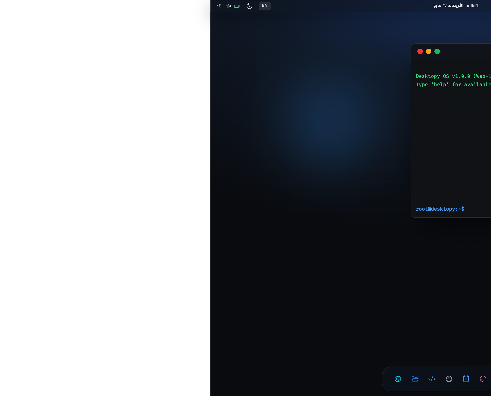

# Web Live Linux

Revamped desktop UI with a dramatic glassmorphism style, ambient grid + glow atmosphere, stronger dock presence, and desktop status widgets while preserving the app interactions and window system.

## Updated Preview

## Logo
The A7een.now logo is displayed in the top status bar (`web-linux-os/public/logo.png`).

